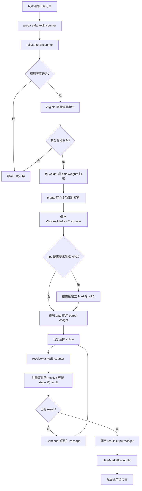
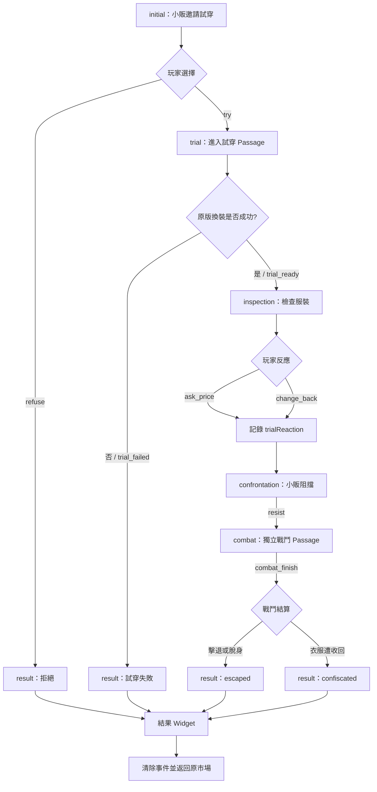
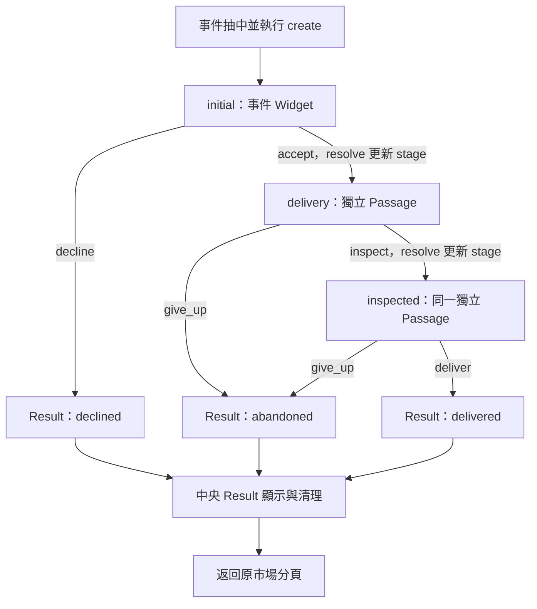

# HonestMarkets 市場隨機事件開發者說明書

> 適用基準：HonestMarkets v0.5.11.32（以 `HonestMarkets_Encounters.js`、`HonestMarkets_Encounters.twee`、`HonestMarkets_Widgets.twee` 及 `HonestMarkets.js` 實際原始碼為準）。本文件說明現有實作，而非承諾穩定的外部 API。新增事件前請確認正在使用相同版本。

## 1. 最重要的設計原則

市場事件不是「註冊一次，之後任意跳 Passage」的鬆散系統。註冊定義、遊戲狀態中的事件實例、Twee Widget、結果 Widget 與返回路徑是一條完整的生命週期。

- **事件定義**：`HM.MARKET_ENCOUNTERS[id]`，包含權重、資格、初始化、選項結算及畫面 Widget 名稱。
- **事件實例**：`State.variables.honestMarketsEncounter`，儲存本次抽中的 ID、目標市場頁、階段、選擇與結果。
- **事件控制器**：`rollMarketEncounter()`、`resolveMarketEncounter()`、`renderMarketEncounter()`、`clearMarketEncounter()`。
- **事件呈現**：Maplebirch gate 攔截指定市場頁，輸出註冊的 `output` Widget；一般續行／結果頁則由中央巨集動態分派。
- **獨立場景**：試穿、戰鬥等可以使用獨立 Passage，但**不可自行取代 `resolve()`、提早清除事件，或將返回頁面寫死**。

### 中央 Passage 不可污染（強制規範）

以下三個 Passage 是 **HonestMarkets 全部市場事件共用的核心入口**，不是個別事件的擴充位置：

- `HonestMarkets Encounter`
- `HonestMarkets Encounter Continue`
- `HonestMarkets Encounter Result`

**新增、修改或修復任何單一事件時，嚴禁修改上述三個中央 Passage。** 這包括但不限於：

1. 不得加入任何事件 ID、事件專屬 `stage`、特殊 `result` 或事件名稱的判斷；不得把某個事件的 Widget、Dispatch Widget 或獨立 Passage 寫入中央分派。
2. 不得因個別事件需要多階段敘述，而新增中央 `if/elseif` 分支、改變通用 `<<honestMarketsEncounter>>`／`<<honestMarketsEncounterResult>>` 的用途，或繞過既有註冊機制。
3. 不得重建、覆寫或簡化中央 Passage；尤其不可意外移除原有的清理、結算、`<<endevent>>`、返回市場等共用收尾操作。既有 `result isnot "escalate"` 等通用條件必須保留。
4. 個別事件的流程一律透過 `registerMarketEncounter()` 的 `create(e)`、`resolve(e, action)`、`output`、`resultOutput` 接入。**`resolve()` 負責狀態轉移；事件自己的 Widget 只負責依目前 `stage` 呈現畫面**。中間階段不可提早設定代表終局的 `e.result`。
5. 需要獨立戰鬥、追逐或其他場景時，使用事件專屬 Passage 與既有 `resolveMarketEncounter(action)` 接回原事件；不得為此修改中央 Passage。代表事件正式結束、返回市場的連結必須按既有通用收尾流程執行 `<<endevent>>`，並避免重複呼叫。

**交付前強制驗證：** 以修改前的同一基準封包為參照，逐字比對這三個 Passage 的完整內容；個別事件的開發封包中，它們必須完全一致。若確實發現中央框架本身有錯誤，應獨立提出核心修正、說明影響範圍並取得明確同意，**不得夾帶在事件修復中**。同時檢查返回連結、`<<endevent>>` 與事件清理流程是否完整，避免僅通過 JavaScript 語法檢查卻破壞遊戲事件生命週期。

### 核心流程圖：事件完整生命週期



圖中「Continue 或獨立 Passage」不代表事件控制權轉移：即使切換場景，仍須透過同一個事件實例及 `resolveMarketEncounter()` 更新進度。

## 2. 檔案分工

| 檔案 | 責任 |
|---|---|
| `HonestMarkets_Encounters.js` | 註冊事件、抽選、資格、狀態、NPC、結果處理、Debug、Maplebirch gate 與 SugarCube 分派巨集 |
| `HonestMarkets_Encounters.twee` | 事件本體 Widget、結果 Widget、中央 Continue／Result Passage、需要獨立呈現的試穿或戰鬥 Passage |
| `HonestMarkets_Widgets.twee` | 市場入口及各分頁；呼叫 `prepareMarketEncounter()`、提供被 gate 攔截的市場畫面 |
| `HonestMarkets.js` | 市場存取、商品、庫存及 `endVisit()` 等一般市場邏輯 |
| `README.md` | 使用者說明與版本紀錄，不應用本開發文件覆蓋 |

## 3. 註冊 API：`HM.registerMarketEncounter(id, definition)`

本節只解釋註冊 API 的參數與限制；**可直接照做的註冊、Widget、選項與 Debug 完整程式碼統一放在第 10 節**，請勿只複製單一片段。

### 3.1 參數詳解

| 欄位 | 型別／預設 | 用途與限制 |
|---|---|---|
| `id` | 非空字串，必填 | 唯一事件 ID，例如 `my_event`；重複註冊會回傳 `false`，不覆蓋原定義 |
| `weight` | 數值，預設 `0` | 候選池中的**相對權重**；必須大於零才會進候選池，不是百分比 |
| `timeWeights` | 物件，可省略 | 依時段 key 設定相對權重倍率；未提供時目前實作以 `1` 計算 |
| `npc` | 布林或整數，預設 `false` | `false` 不生成；`true` 保持舊行為（生成一名）；`1`～`6` 依序生成指定數量的 NPC。不是自動啟動戰鬥 |
| `output` | Widget 名稱字串 | gate／`honestMarketsEncounter` 所呈現的**事件本體** Widget |
| `resultOutput` | Widget 名稱字串 | `honestMarketsEncounterResult` 所呈現的**事件結果** Widget |
| `eligible()` | 函式，可省略 | 候選資格；應為無副作用的布林判斷，不得在此抽獎、扣款、變更存檔或跳頁 |
| `create(e)` | 函式，可省略 | 抽中後呼叫一次；在 `e` 上記錄商品、價格、分支、亂數等本次固定資料 |
| `resolve(e, action)` | 函式，可省略 | 處理選項及副作用；不接受的 action／階段回傳 `false`，成功時回傳非 `false` |

**註冊注意事項：** `registerMarketEncounter()` 只做基本重複 ID 檢查，沒有完整 schema 驗證；Widget 名稱、action 與階段必須一致。時段權重目前的實作會將 `0` 回退成 `1`，若要限制事件出現，請透過 `eligible()` 判斷。

### 3.2 多名 NPC（可選、向下相容）

原版 `<<generateNPC 1>>` 至 `<<generateNPC 6>>` 對應 `$NPCList[0]` 至 `$NPCList[5]`，最多六個插槽；`<<generate1>>` 等只是其便捷包裝。市場事件的 `npc` 欄位因此支援 `false`、`true` 或整數 `1`～`6`，不必修改任何既有註冊：

```js
npc: false, // 不建立 NPC（預設）
npc: true,  // 建立一名，維持既有事件行為
npc: 3,     // 依序建立 NPC 1、2、3
```

NPC 在 `create(e)` 完成、事件實例儲存後才生成；`create(e)` 不應假設新 NPC 已存在。生成時會使用原版 `<<generateNPC N>>`，保留原版的 `NPCList`、`enemyno` 與 `EventSystem` 行為。沿用舊版的 `<<person1>>` 顯示第一名 NPC；**其餘 NPC 不會自動插入敘述**，事件的 Twee Widget 應依需求使用原版 NPC 描述 Widget 或 `$NPCList`。若需要特定性別、年齡、角色、伴侶關係，請在事件內依原版相關 Widget 另行設計，不能假定 `npc: 3` 會自動指定關係。

`npc` 不代表開始戰鬥；戰鬥仍需依原版流程處理。數量超出 1～6 或使用非整數時不生成 NPC；請使用明確合法的設定。

### 3.3 時段 key 與總觸發率

| 時間（`Time.hour`） | key | 本次市場遭遇總觸發率 |
|---|---|---:|
| 06:00–06:59 | `preparing` | 40% |
| 07:00–09:59 | `morning` | 45% |
| 10:00–15:59 | `daytime` | 45% |
| 16:00–18:59 | `peak` | 55% |
| 19:00–20:59 | `late` | 50% |
| 21:00–21:59 | `closing` | 40% |
| 22:00–05:59 | `closed` | 正常流程不觸發 |

基礎 `MARKET_ENCOUNTER_CHANCE = 40`；正常觸發使用 `max(40, timeInfo.chance)`。**先判斷是否發生任何事件，再抽事件種類**。例如兩個合資格事件的有效權重分別為 10 和 30，則在「已發生事件」的前提下，其被選中的相對機率為 25% 與 75%；不是整體市場進入時直接有 10% 或 30% 的機率。權重還會因 `eligible()` 篩掉其他事件而重新正規化。

## 4. 事件何時被建立

市場入口可以先呼叫 `prepareMarketEncounter()` 再切換市場分頁；對應 Twee 寫法集中列於第 10 節。


`prepareMarketEncounter(targetPassage, source)` 轉呼叫 `rollMarketEncounter(source, null, normalizeEncounterPassage(targetPassage))`。此外，市場的「探索更多」等操作也可能再次準備事件。**抽選在實際切換目標 Passage 之前發生**，所以 `eligible()` 若要判斷場景，應使用 `HM.isPassage("HonestMarkets Clothing")` 或抽選期間的目標場景資訊，不能只看尚未切換的目前頁面。

`rollMarketEncounter()` 依序：刪除舊的 `V.honestMarketsEncounter`、取得時段、擲總觸發率、篩選候選、按權重選出定義、建立實例、執行 `create()`、保存實例、視 `npc` 建立 NPC。`create()` 失敗會寫入 console 並放棄本次事件；`eligible()` 出錯則記錄 console 並排除該候選。**不要把有副作用的動作放在 `eligible()`，因為它可能被多次呼叫，包括 Debug 畫面刷新。**

本次事件實例的資料形狀範例集中列於第 10 節。


`e` 儲存在 `State.variables.honestMarketsEncounter`，所以要保存可序列化的普通資料；避免保存 DOM、函式、循環引用或只在目前頁面有效的物件。`create()` 應鎖定價格與隨機結果，避免重繪時變動。

## 5. Maplebirch gate 如何讓事件出現

`registerMarketEncounterStateEvents()` 為每個註冊事件建立 `maplebirch.dynamic.regStateEvent("gate", "HonestMarkets:encounter:" + id, ...)`，主要設定：

- `output: def.output`：使用註冊的事件 Widget 名稱。
- `cond()`：**只檢查**已保存的 encounter ID 和目前市場 Passage 是否符合 `targetPassage`；不重新擲骰。
- `forceExit: true`：命中後由事件內容接管該次市場畫面。
- `priority: 50`：註冊優先序。
- `extra.passage`：`HonestMarkets Products`、`HonestMarkets Category`、`HonestMarkets Seeds`、`HonestMarkets Clothing`。

對 `HonestMarkets Products` 目標，`HonestMarkets Category` 也視為可匹配；其他目標要求精確匹配。Maplebirch 尚未可用時，程式會嘗試於首次 `:passageinit` 再註冊。**gate 的職責是顯示 pending 事件，不是負責選項、結算或返回。**

**重要：**事件 Widget 不應透過互相引用造成循環呼叫；畫面顯示與事件進度更新必須分開。

## 6. Widget、Continue、Result 的分派方式

中央 SugarCube 巨集在 `HonestMarkets_Encounters.js` 註冊（原始碼摘錄集中列於第 10 節）：


`renderMarketEncounter(false)` 查詢目前事件定義的 `output`，回傳 `<<事件Widget名稱>>`；`true` 查詢 `resultOutput`。沒有事件則回傳空字串。

- `HonestMarkets Encounter`：直接呼叫 `<<honestMarketsEncounter>>`。
- `HonestMarkets Encounter Continue`：若事件存在且尚未設定 `result`，重新渲染**目前註冊事件**的本體 Widget；否則轉入 `HonestMarkets Encounter Result`。
- `HonestMarkets Encounter Result`：呼叫 `<<honestMarketsEncounterResult>>`，對一般非 `escalate` 結果清除事件，並提供返回連結。`escalate` 是現有事件的特殊分支，不應不加思索套用到新事件。

### 完整範例與中央分派器的關係

第 10 節已將**註冊、兩個 action、兩個 Widget、Debug 名稱及完整執行順序**放在同一個範例中。中央 `HonestMarkets Encounter Result` 由系統提供，不需要為每個事件重新製作。

在 Widget 的 `<<link>>` 內呼叫 `resolveMarketEncounter()`，是因為連結內容會在玩家點擊時執行；不要把一次性扣款、給物品或階段變更直接放在可能反覆渲染的 Widget 本體。

## 7. 狀態機：`stage`、`action`、`result` 各管什麼

| 欄位 | 誰寫入 | 意義 |
|---|---|---|
| `e.stage` | 建立時預設 `initial`；後續由事件 `resolve()` 更新 | 事件目前進度；決定下次顯示哪段劇情及哪些 action 合法 |
| `e.action` | 中央 `resolveMarketEncounter(action)` 在呼叫事件 `resolve()` **之前**寫入 | 最後提交的 action；**即使 resolve 回傳 false 仍可能被寫入**，不能當成功憑據 |
| `e.result` | 事件 `resolve()` | 表示已有結局；中央 Continue 會轉往結果頁 |
| 事件專屬欄位 | `create()` 或 `resolve()` | 商品 ID、數量、價格、玩家反應、試穿服裝清單等 |

建議所有分支同時檢查 `action` 與 `stage`，例如 `if (action === "accept" && e.stage === "initial")`。不符合階段時回傳 `false`，避免使用者透過返回鍵、重複點擊或 Debug 跳頁，對同一事件重複領獎、扣款或重新生成 NPC。

## 8. 跨 Passage 的正確方式：以小販事件為實例

現有 `suspicious_clothier` 是多階段案例，包含 `initial`、`trial`、`inspection`、`confrontation`、`combat`，最後透過 `result` 結算。

| 玩家行為 | 呼叫的 action | 前置 stage | 更新後 |
|---|---|---|---|
| 拒絕試穿 | `refuse` | `initial` | `e.result = "refused"` |
| 接受試穿 | `try` | `initial` | `trial` |
| 原版換裝成功並記錄服裝 | `trial_ready` | `trial` | `inspection` |
| 詢問價格 | `ask_price` | `inspection` | `trialReaction` 記錄選擇，轉 `confrontation` |
| 嘗試換回服裝 | `change_back` | `inspection` | `trialReaction` 記錄選擇，轉 `confrontation` |
| 換裝失敗 | `trial_failed` | `trial` | `e.result = "trial_failed"` |
| 推開小販、進入戰鬥 | `resist` | `confrontation` | `combat` |
| 戰鬥結算 | `combat_finish` | `combat` | 設定 `escaped` 或 `confiscated` |

### 8.1 為什麼試穿可以獨立 Passage

`HonestMarkets Clothier Trial` 需要執行原版 `<<upperwear>>`／`<<lowerwear>>`，因此可獨立顯示；但它仍讀取 `getMarketEncounter()`，檢查 `id` 和 `stage`，並以 `resolveMarketEncounter("trial_ready")` 將進度交回註冊事件。它**不是第二套獨立的事件控制器**。

試穿時 `clothierRecordTrial()` 只負責記錄本次衣服的 slot、name、index、colour，供結算辨識；`resolve()` 負責階段變化。詢問價格或換衣選項會寫入 `e.trialReaction`，下個場景與戰鬥開場可以讀取，不必另設永久 `$` 變數。

### 8.2 為什麼戰鬥仍應保留事件實例

`HonestMarkets Clothier Combat` 是獨立的戰鬥 Passage，但它只負責原版戰鬥巨集、首次開場文案與回合操作；事件勝負結算仍交由 `resolveMarketEncounter("combat_finish")`。`HonestMarkets Clothier Combat Finish` 會呼叫 `<<clotheson>>`、事件 `resolve()`、`<<endcombat>>`，再呈現 `<<honestMarketsEncounterResult>>`。**必須在結果 Widget 渲染後才清除事件**，否則結果分派器會失去 ID、選擇與結果。

本事件的勝負判定由註冊的 `resolve()` 讀取戰鬥狀態：敵方生命值小於等於零則 `escaped`；否則若敵方興奮值達上限，呼叫 `clothierConfiscate()` 並設為 `confiscated`；其他情況設為 `escaped`。戰鬥 Passage 不應另寫一套與註冊定義互相矛盾的事件結算。

### 8.3 多階段事件流程圖



每一條箭頭所對應的玩家行為都應交由註冊事件的 `resolve(e, action)` 判斷是否合法。獨立 Passage 負責場景內容，不另建平行的事件狀態機。

## 9. 返回原市場頁與事件清理

`marketEncounterReturnPassage()` 的優先序：

1. 尚存在事件時的 `encounter.targetPassage`。
2. `State.variables.honestMarketsEncounterReturnPassage`（`clearMarketEncounter()` 保存的返回目標）。
3. 預設 `HonestMarkets Products`。

`HonestMarkets Category` 會被正規化成 `HonestMarkets Products`。標準結局可讓 `HonestMarkets Encounter Result` 自行清除；獨立結算 Passage 若自行清除，應先完成結果渲染，再呼叫 `clearMarketEncounter()`，並透過 `marketEncounterReturnPassage()` 取得連結目的地。不要硬寫 `HonestMarkets Products` 或 `HonestMarkets Clothing`。


`endVisit()` 是離開市場時的較大範圍清理，會刪除市場訪問狀態與當前 encounter；**不要把它當作每個事件的正常結算函式**。

## 10. 集中範例程式碼：從註冊到結算

本章是**唯一集中放置可複製實作範例的章節**。包含「範例一：單階段事件」及「範例二：多階段分支、跨 Passage 事件」。兩者彼此獨立，均一次提供全部必要的註冊、Widget、Passage、結果及 Debug 名稱。其他章節專注於 API 規則與流程，不在後面補充範例缺失的必要步驟。

### 範例一：單階段事件（my_event）

以下是一個**從註冊到結束都完整可對照**的單階段事件範例。先看完整範例，再閱讀參數與運作原理；不要只複製其中一段而遺漏選項、結果或 Debug 名稱。這個範例不依賴獨立 Passage，適合先確認事件系統的基本生命週期。

**步驟 A：在 `HonestMarkets_Encounters.js` 註冊事件**（放在現有事件註冊區域，沿用該檔已存在的 `HM` 變數）。

```javascript
HM.registerMarketEncounter("my_event", {
    weight: 10,
    timeWeights: { morning: 0.8, daytime: 1, peak: 1.5 },
    npc: false,
    output: "HonestMarketsEncounterMyEvent",
    resultOutput: "HonestMarketsEncounterMyEventResult",
    eligible() {
        return true;
    },
    create(e) {
        // 抽中時鎖定本次獎勵；重繪 Widget 不會重新抽選。
        e.reward = 20;
    },
    resolve(e, action) {
        // 同一階段的兩個選項，均由註冊事件負責結算。
        if (e.stage !== "initial") return false;
        if (action === "accept") {
            // 此範例只記錄結果；實際獎勵可在這裡一次性發放。
            e.result = "accepted";
            return true;
        }
        if (action === "decline") {
            e.result = "declined";
            return true;
        }
        return false;
    }
});

// 將此項併入現有 HM.marketEncounterLabels 物件，勿覆蓋整張表。
// my_event: "我的新事件",
```

**步驟 B：在 `HonestMarkets_Encounters.twee` 定義本體及結果 Widget**（兩個 Widget 名稱須與註冊欄位完全一致）。

```twee
<<widget "HonestMarketsEncounterMyEvent">>
    <<set _hmEncounter to setup.HonestMarkets.getMarketEncounter()>>
    <<if _hmEncounter and _hmEncounter.id is "my_event" and _hmEncounter.stage is "initial">>
        一名攤販向你打招呼，提出一個簡單的邀請。<br><br>
        <<link "接受" "HonestMarkets Encounter Result">>
            <<run setup.HonestMarkets.resolveMarketEncounter("accept")>>
        <</link>><br>
        <<link "婉拒" "HonestMarkets Encounter Result">>
            <<run setup.HonestMarkets.resolveMarketEncounter("decline")>>
        <</link>>
    <</if>>
<</widget>>

<<widget "HonestMarketsEncounterMyEventResult">>
    <<set _hmEncounter to setup.HonestMarkets.getMarketEncounter()>>
    <<if _hmEncounter and _hmEncounter.id is "my_event">>
        <<if _hmEncounter.result is "accepted">>
            攤販笑著向你道謝。<br><br>
        <<elseif _hmEncounter.result is "declined">>
            你婉拒了邀請，繼續逛市場。<br><br>
        <</if>>
    <</if>>
<</widget>>
```

**步驟 C：將 `my_event: "我的新事件",` 加入既有 `HM.marketEncounterLabels`**，即可在 Debug 選單中看到中文名稱。一般市場入口與中央 Result Passage 已由系統提供，**不需要再自行建立或重複註冊**。

**這個範例的完整執行順序：**市場準備抽選 → `eligible()` 通過 → 依權重抽中 → `create(e)` 寫入獎勵 → gate 顯示本體 Widget → 玩家點選 `accept` 或 `decline` → `resolveMarketEncounter()` 呼叫本事件的 `resolve()` → 設定 `e.result` → 既有 `HonestMarkets Encounter Result` 分派結果 Widget → 中央流程清理事件並返回原市場頁。若日後加入跨 Passage，仍應維持同一套 `resolve()` 控制方式。


### 範例二：多階段分支＋跨 Passage（market_delivery_demo）

這是一個**獨立、完整的第二個事件**，不依賴範例一。情境是攤販請玩家幫忙把包裹送到附近攤位；玩家可以直接拒絕，也可以接受後前往獨立 Passage 檢查包裹，再決定送達或放棄。**每個選項都經過註冊事件的 `resolve()`**，獨立 Passage 只負責畫面，不自行改寫 `stage`、`result` 或清除事件。

**流程圖（包含分支、跳頁、結算）**



**步驟 A：在 `HonestMarkets_Encounters.js` 現有事件註冊區域加入以下完整定義**（使用檔案既有的 `HM`，不要額外建立另一套管理器）。

```javascript
HM.registerMarketEncounter("market_delivery_demo", {
    weight: 8,
    timeWeights: { morning: 1, daytime: 1, peak: 0.8 },
    npc: false,
    output: "HonestMarketsEncounterDeliveryDemo",
    resultOutput: "HonestMarketsEncounterDeliveryDemoResult",
    eligible() {
        // 此示例不限定市場分頁；不在資格檢查中修改狀態。
        return true;
    },
    create(e) {
        // 本次事件資料在建立時固定；跨 Passage 仍從同一事件物件讀取。
        e.packageName = "用繩子綁好的小包裹";
    },
    resolve(e, action) {
        // 以階段白名單檢查動作，避免從其他 Passage 跳入時越級結算。
        if (e.stage === "initial") {
            if (action === "decline") {
                e.result = "declined";
                return true;
            }
            if (action === "accept") {
                e.stage = "delivery";
                return true;
            }
            return false;
        }
        if (e.stage === "delivery") {
            if (action === "inspect") {
                e.stage = "inspected";
                return true;
            }
            if (action === "give_up") {
                e.result = "abandoned";
                return true;
            }
            return false;
        }
        if (e.stage === "inspected") {
            if (action === "deliver") {
                e.result = "delivered";
                return true;
            }
            if (action === "give_up") {
                e.result = "abandoned";
                return true;
            }
            return false;
        }
        return false;
    }
});

// 在「現有」HM.marketEncounterLabels 物件中增加一個屬性，
// 不要重新賦值覆蓋整張名稱表：
// market_delivery_demo: "代送包裹",
```

**步驟 B：在 `HonestMarkets_Encounters.twee` 加入事件本體與結果 Widget。** 事件本體只負責開場，`accept` 更新階段後才前往獨立 Passage；拒絕則直接前往中央結果頁。

```twee
<<widget "HonestMarketsEncounterDeliveryDemo">>
    <<set _hmEvent to setup.HonestMarkets.getMarketEncounter()>>
    <<if _hmEvent and _hmEvent.id is "market_delivery_demo" and _hmEvent.stage is "initial" and !_hmEvent.result>>
        一名攤販拿著一個綁好的包裹，詢問你能否幫忙送到附近的攤位。<br><br>
        <<link "答應幫忙" "HonestMarkets Delivery Demo">>
            <<run setup.HonestMarkets.resolveMarketEncounter("accept")>>
        <</link>><br>
        <<link "婉拒" "HonestMarkets Encounter Result">>
            <<run setup.HonestMarkets.resolveMarketEncounter("decline")>>
        <</link>>
    <</if>>
<</widget>>

<<widget "HonestMarketsEncounterDeliveryDemoResult">>
    <<set _hmEvent to setup.HonestMarkets.getMarketEncounter()>>
    <<if _hmEvent and _hmEvent.id is "market_delivery_demo">>
        <<if _hmEvent.result is "declined">>
            你婉拒了請求，攤販點點頭，轉身尋找其他人。<br><br>
        <<elseif _hmEvent.result is "abandoned">>
            你把包裹交還攤販，決定不再參與這件事。<br><br>
        <<elseif _hmEvent.result is "delivered">>
            你將包裹送到指定攤位，完成了這次委託。<br><br>
        <</if>>
    <</if>>
<</widget>>
```

**步驟 C：仍在 `HonestMarkets_Encounters.twee` 加入完整獨立 Passage。** 它會依照事件的 `stage` 顯示不同選項；使用者從舊存檔或不正確的入口跳入時，不允許直接領取結果。所有正常分支均透過 `resolveMarketEncounter()`，不在 Passage 中直接修改 `e.stage` 或 `e.result`。

```twee
:: HonestMarkets Delivery Demo[]
<<set _hmEvent to setup.HonestMarkets.getMarketEncounter()>>
<<if !_hmEvent or _hmEvent.id isnot "market_delivery_demo" or _hmEvent.result>>
    這項委託目前無法繼續。<br><br>
    <<link "返回市場" setup.HonestMarkets.marketEncounterReturnPassage()>><</link>>
<<elseif _hmEvent.stage is "delivery">>
    你拿著<<print _hmEvent.packageName>>，來到相鄰的攤位前。<br><br>
    <<link "先確認包裹上的標記" "HonestMarkets Delivery Demo">>
        <<run setup.HonestMarkets.resolveMarketEncounter("inspect")>>
    <</link>><br>
    <<link "放棄委託" "HonestMarkets Encounter Result">>
        <<run setup.HonestMarkets.resolveMarketEncounter("give_up")>>
    <</link>>
<<elseif _hmEvent.stage is "inspected">>
    你確認包裹上的攤位標記，找到了正確的收件人。<br><br>
    <<link "交付包裹" "HonestMarkets Encounter Result">>
        <<run setup.HonestMarkets.resolveMarketEncounter("deliver")>>
    <</link>><br>
    <<link "改變主意，放棄委託" "HonestMarkets Encounter Result">>
        <<run setup.HonestMarkets.resolveMarketEncounter("give_up")>>
    <</link>>
<<else>>
    委託尚未進入可以操作的階段。<br><br>
    <<link "返回事件" "HonestMarkets Encounter Continue">><</link>>
<</if>>
```

**步驟 D：在現有 `HM.marketEncounterLabels` 物件中補上 Debug 名稱。** 此行是新增到原物件內，不是另建物件或在外部重複宣告。

```javascript
market_delivery_demo: "代送包裹",
```

**完整執行順序：**抽選 → `create()` → 本體 Widget → `accept` / `decline` →（接受時）`stage=delivery` → 獨立 Passage → `inspect` → `stage=inspected` → `deliver` / `give_up` → `result` → 既有中央 `HonestMarkets Encounter Result` 顯示結果 Widget → 清除事件 → 返回原市場頁面。**不需要自行複製中央 Continue 或 Result Passage，也不需要自行呼叫 `clearMarketEncounter()`。**

**範例邊界：**這是流程教學，不含實際搬運獎勵或時間成本。若新增金錢、物品或時間變更，應在 `resolve()` 對應合法階段的動作中執行一次，不能放在可能反覆渲染的 Widget。另需注意目前中央 `resolveMarketEncounter()` 在呼叫事件 `resolve()` 前就會寫入 `e.action`，且 `false` 不會自動阻止 `<<link>>` 的 Passage 跳轉；所以本範例只在對應階段提供合法選項，並在獨立 Passage 驗證事件 ID 與階段。若需要防禦惡意或失效的舊連結，須另外設計導航保護，不可誤以為 `return false` 自動取消跳頁。


### 補充參考：系統既有入口、分派與診斷

以下為理解既有機制的參考片段，**不是新增 `my_event` 的必要程式碼**，不要把中央分派巨集重複註冊。

**市場入口連結示例**

```twee
<<link [[購買服裝|HonestMarkets Clothing]]>>
    <<run setup.HonestMarkets.prepareMarketEncounter("HonestMarkets Clothing", "clothing")>>
<</link>>
```

**事件實例資料形狀**

```javascript
{
    id: "my_event",
    source: "clothing",          // 例如入口／刷新／debug 的來源
    targetPassage: "HonestMarkets Clothing",
    stage: "initial",
    createdAt: 1790000000000,  // 示意值，實際為 Date.now()
    reward: 20                 // create() 加入的事件專屬欄位
}
```

**中央分派巨集**

```javascript
Macro.add("honestMarketsEncounter", {
    handler() { new Wikifier(this.output, HM.renderMarketEncounter(false)); }
});
Macro.add("honestMarketsEncounterResult", {
    handler() { new Wikifier(this.output, HM.renderMarketEncounter(true)); }
});
```

**獨立結算 Passage**

```twee
<<honestMarketsEncounterResult>>
<<run setup.HonestMarkets.clearMarketEncounter()>>
<<link "繼續逛市集" setup.HonestMarkets.marketEncounterReturnPassage()>><</link>>
```

**Debug 名稱單行寫法**

```javascript
my_event: "我的新事件",
```

**控制台診斷程式**

```javascript
const HM = setup.HonestMarkets;
console.table({
    passage: State.passage,
    eventId: HM.getMarketEncounter()?.id,
    stage: HM.getMarketEncounter()?.stage,
    action: HM.getMarketEncounter()?.action,
    result: HM.getMarketEncounter()?.result,
    target: HM.getMarketEncounter()?.targetPassage,
    returnTo: HM.marketEncounterReturnPassage()
});
```

Debug 介面僅在 `State.variables.debug === 1` 時顯示。強制觸發略過一般總觸發率，但仍檢查 `eligible()`；測試時避免覆蓋尚未結束的事件。

## 11. 事件流程常見錯誤

| 現象 | 優先檢查 |
|---|---|
| 事件永遠不出現 | `weight > 0`、`eligible()`、目標 Passage、時段、候選池、總觸發率 |
| Debug 選單是英文 | `HM.marketEncounterLabels` 缺少 ID |
| Widget 錯誤訊息無限巢狀 | 同名 Widget、`<<include>>`、循環呼叫鏈、分派器重入 |
| 開場正常，後續選項與事件脫節 | 直接跳 Passage，沒有呼叫 `resolveMarketEncounter(action)` 更新 `stage` |
| 點了選項卻沒有進度 | action 拼字、前置 stage、`resolve()` 回傳 `false` |
| 結果 Widget 空白 | 過早 `clearMarketEncounter()`、未設定 `result`、`resultOutput` 名稱錯誤 |
| 回到錯誤市場頁 | 返回頁面寫死、事件 `targetPassage` 遺失、過早 `endVisit()` |
| 重複領獎／扣款 | 副作用寫在可重繪的 Widget、缺少 stage 防重入、在 eligible 中修改狀態 |
| 隨機獎品每次畫面刷新都變 | 隨機結果寫在 Widget 而不是 `create()` |

## 12. 新事件開發檢查清單

- [ ] 使用唯一 ID 註冊，檢查 `registerMarketEncounter()` 回傳值。
- [ ] 設定合理的 `weight`、`timeWeights`、`npc`。
- [ ] `eligible()` 只讀判斷；需要限定市場分頁時使用正確的目標 Passage。
- [ ] 在 `create(e)` 一次性鎖定商品、價格、隨機結果，且只儲存可序列化資料。
- [ ] 定義 `output`、`resultOutput` 並確認 Twee Widget 名稱完全一致。
- [ ] 每個玩家選項都呼叫 `resolveMarketEncounter(action)`；每個 action 都有合法 stage 檢查。
- [ ] 跨 Passage 時保留 `getMarketEncounter()`、`stage` 與事件 ID 檢查。
- [ ] 獨立戰鬥只處理戰鬥畫面；事件勝負與獎懲回寫註冊的 `resolve()`。
- [ ] 在結果 Widget 完成渲染後才清除事件。
- [ ] 返回連結使用 `marketEncounterReturnPassage()`，不要寫死市場分頁。
- [ ] 在 `marketEncounterLabels` 補上繁體中文名稱。
- [ ] 驗證一般觸發、Debug 強制觸發、拒絕、成功、失敗、返回鍵與重複進入。
- [ ] 測試各 action 是否依照 `stage` 更新、結算後是否清除事件及返回正確分頁。

## 13. 推薦的事件開發順序

1. 先寫最小 `registerMarketEncounter()`、本體 Widget、結果 Widget，驗證能從市場抽中、顯示、結束、返回。
2. 再加入 `eligible()` 場景限制與 `create()` 隨機資料，確保重繪不改結果。
3. 增加 `stage` 和 action，先以兩階段劇情測試 `HonestMarkets Encounter Continue`。
4. 確定所有選項都經 `resolve()` 後，再加入試穿、購物、戰鬥等獨立 Passage。
5. 最後才加劇情文案、隨機文本、特殊勝負、服裝處理與視覺效果。

**總結：註冊定義是規則，`V.honestMarketsEncounter` 是本次進度，Widget 是畫面，Passage 是場景，`resolveMarketEncounter()` 是選項與狀態變化的唯一中央入口。** 這五者要保持一致，事件才不會在第一次跳頁後失去註冊系統的管理。

## 14. 新事件設計建議（非強制規範）

> **本節屬於建議採用的最佳實務，不是註冊 API 的硬性要求。** 第 1～12 節所述的事件生命週期、`resolveMarketEncounter()`、結果清理及返回路徑等整合要求仍應遵守。實作時以事件複雜度為準，避免為了套用建議而增加不必要的層次。

### 14.1 優先分離 JS 與 Twee 的責任

| 類型 | 建議放置位置 | 原因 |
|---|---|---|
| 觸發條件、權重、隨機抽選、能力門檻 | `HonestMarkets_Encounters.js` | 集中維護遊戲規則 |
| `stage`、選項結果、金錢／屬性變化、NPC 或衣物操作 | `HonestMarkets_Encounters.js` 的 `create(e)`／`resolve(e, action)` | 副作用集中且容易防止重複執行 |
| 固定文章結構、劇情敘述、對白、段落順序、差分插入位置 | `HonestMarkets_Encounters.twee` 的 Widget | Twee 掌握整篇文章的組成與節奏 |
| 簡單、局部且無跨段關聯的隨機文字 | `HonestMarkets_Encounters.twee` 中的 `<<either>>` 或簡單 `<<if>>` | 直接就地維護，不必為少量句子建立 JS 詞庫 |
| 複雜或大量的隨機敘事差分詞庫 | `HonestMarkets_Encounters.js` 中各事件獨立的詞庫 | 便於擴充、配對與分類，避免 Twee 充滿巢狀隨機分支 |
| 玩家可見選項、結果畫面 | Twee Widget | 介面與文案保持在同一層 |
| 事件轉場 | 既有中央 Continue／Result Passage | 保留註冊事件的統一流轉 |

原則上，**Twee 始終負責固定文章結構、段落順序、差分插入位置及敘事流程；JS 負責事件規則與需要集中管理的複雜詞庫**。簡單的局部隨機句子可直接由 Twee 抽取，不必為每個隨機差分建立 JS 詞庫或專用 Widget。

### 14.2 隨機結果與文字變化要能安全重繪

- 在 `create(e)` 或合法的 `resolve(e, action)` 中抽選，將結果、金額、分支或文案索引保存於事件實例；Twee 依既有資料顯示，不在渲染過程重新擲骰。
- 多輪事件若希望避免同一段文字重複，可以在 JS 保存「已使用的文案索引」；對詞庫式差分，Twee 只取出已鎖定的詞庫項目並在預定位置輸出，不在 JS 拼接整篇文章。
- 需要根據能力或玩家狀態改變敘述時，優先讓 JS 鎖定判定結果或分級；Twee 可依分級顯示固定差分，或取出該事件詞庫的對應文字，避免反覆渲染造成不同敘述。
- 不要在 `output`／`resultOutput` Widget 的渲染過程中發錢、扣時間、修改能力或執行其他不可重複的副作用。

### 14.2.1 詞庫式敘事差分（新事件建議）

**採複雜度導向的混合實作，而非一律 JS 詞庫化。** 少量、局部、彼此獨立的隨機句子可直接由 Twee 的 `<<either>>` 處理；少量簡單條件差分可用 `<<if>>` 搭配 `<<either>>`。涉及大量變體、多重條件、分級、權重、跨句配對或需要保存抽取結果時，才建議採事件專屬 JS 詞庫。無論選哪種方式，**Twee 仍控制固定文章結構與敘事流程**。既有正常運作的事件不必為了統一格式而重構。

0. **依複雜度選擇實作**：Twee 的簡單局部隨機差分不必搬到 JS；只有條件或變體複雜到影響閱讀與維護時，才改用獨立 JS 詞庫。簡單的 `<<either>>` 若每次重繪允許變動，可直接使用；若必須維持同一次事件的固定結果，仍需預先鎖定選擇或索引，不應依賴重繪時重新抽取。
1. **事件詞庫彼此獨立**：每個事件只維護自己的詞庫，例如 `underwear_collector.touchLiquid` 與其他事件自己的差分資料。共用的可以是抽取工具，不應強迫事件共用敘事內容、人物設定或判定欄位。
2. **同一事件內，各差分區塊職責獨立**：開場動作、即時生理／心理反應、特殊條件、NPC 評語、互動後的交易心理等分別管理。每個區塊只描述自己負責的時點與面向；不得預設其他隨機區塊抽到了什麼，也不要重複描寫同一種反應。
3. **Twee 保留固定文章結構**：固定段落、敘事順序、插入點、選項、結算與收尾都由 Twee 控制；詞庫僅提供該位置需要填入的文字。隨機詞庫不得自行寫入「收手、退開、付款、離開」等應由固定流程統一描述的動作，也不應擅自推進 `stage`。
4. **按需求使用單段或成對詞庫**：簡單反應可使用單一字串；有因果或呼應關係的文字可使用 `{ a, b }`，**先抽一個項目，再輸出同一項目的 A 與 B**，不可各自抽取造成錯配；複雜事件也可有自己的多段結構，不強制全部使用 A／B。
5. **抽取結果與條件應鎖定**：事件建立或合法 `resolve()` 階段決定分級與索引，保存於該事件實例；重繪時僅依已保存資料讀取詞庫。不同區塊使用獨立索引，除非明確設計成彼此配對；避免在 Twee 渲染時重新擲骰。
6. **詞庫應保持純敘事資料**：不在詞庫項目中發錢、扣時間、修改屬性、切換 Passage 或結束事件。特殊條件的優先順序（例如精液優先於濕潤度）由事件判定函式決定，不讓詞庫自行改變遊戲狀態。
7. **避免過早抽象化**：新事件可先建立自己清楚的詞庫與抽取函式；等多個事件確實有相同需求時，再考慮提取通用抽取工具，不為了架構一致而修改既有事件。

簡單差分直接由 Twee 處理的示意：

```twee
固定開場敘述。<br><br>
<<either>>
    他好奇地打量著你。
<<or>>
    他露出一絲期待的笑容。
<<or>>
    他若有所思地點點頭。
<</either>>
固定收尾敘述。<br><br>
```

此例適用於**允許重繪時重新抽選**的純局部文案；需要重繪一致性時，應先鎖定選擇，不能直接照搬。

示意（僅供新事件參考，不代表現有 API 或要求改寫收藏家事件）：

```js
// JS：此事件自己的敘事詞庫；不包含劇情流程或副作用。
const eventNarrative = {
    immediateReaction: ["反應甲。", "反應乙。"],
    specialPairs: [
        { a: "特殊感受甲。", b: "對應延伸甲。" },
        { a: "特殊感受乙。", b: "對應延伸乙。" }
    ]
};
// 在合法事件階段鎖定各區塊的索引，再由 Twee 依索引取得文字。
```

```twee
<!-- Twee：固定文章結構與插入順序，示意變數由事件 Widget 預先取得。 -->
固定開場敘述。<br><br>
<<print _immediateReaction>><br><br>
<<if _specialPair>>
    <<print _specialPair.a>><br><br>
    <<print _specialPair.b>><br><br>
<</if>>
固定收尾敘述。<br><br>
```

**差分校稿重點**：把每個區塊的不同候選文字交叉組合測試，確認任意組合都不矛盾、不重複、不越權敘述其他區塊的進度；同時檢查特殊條件優先順序、分級門檻及重繪時的穩定性。

### 14.3 多階段事件優先使用中央流程

一般劇情階段（接受、拒絕、展示、交談、拍照、結算等）建議透過 `resolveMarketEncounter(action)` 更新 `stage`，再由中央 Continue／Result Passage 分派 Widget。**不建議僅為普通劇情階段建立專用 Passage**，也不應讓專用 Passage 自行取代註冊事件的狀態機。

確實需要原版戰鬥、試穿或其他獨立遊戲場景時，可以使用專用 Passage；但仍須保存同一事件實例，並透過註冊事件的 `resolve()` 回寫結果。這是既有架構允許的例外，不必強行將戰鬥畫面塞入一般 Widget。

### 14.4 優先沿用原版遊戲機制

涉及服裝穿脫、NPC 生成、戰鬥、金錢與屬性變化時，先查明現有原版 API／Widget 的資料形狀與前置條件，盡可能直接呼叫，而不是自行重寫套裝配對、穿著狀態或結算規則。若需暫存狀態，應考慮失敗復原及原有狀態還原；避免為罕見的非正常跳頁情境加入過度複雜的全域攔截。

### 14.5 依事件規模選擇拆分程度

- **簡單單階段事件**：註冊、開場 Widget、`resolve()`、結果 Widget 即可，不必拆成大量小 Widget。
- **多階段事件**：建議明確設計 `stage` 與 action 對應關係，將每個分支的敘述集中在 Twee。
- **含能力差分、隨機文案或複雜結果的事件**：建議預先保存判定／文案索引、避免重複文本，並分開測試各種結果。

可參考 **v0.5.11.32「臨時服裝模特兒」事件**的設計方向：中央註冊流程、JS 判定與狀態、Twee 劇情與選項、固定每輪隨機結果。這是較複雜事件的參考案例，**不是要求所有新事件複製同樣的階段數量或 Widget 數量**。

### 14.6 文件與維護建議

新增事件時，建議使用繁體中文註解說明必要的前置條件、狀態變化與復原原因；保留原作者資訊，避免留下無助於維護的開發歷程註解。README 更新日誌集中記錄對玩家或後續維護有意義的變更。

**建議性自查：** Twee 是否保留固定文章結構？簡單局部隨機文字是否可直接留在 Twee、避免過度詞庫化？複雜隨機差分是否使用事件獨立詞庫且各區塊職責清楚？成對文字是否綁定抽取？隨機判定是否只執行一次？普通階段是否沿用中央流程？有無重寫原版已提供的機制？是否為簡單事件增加了不必要的抽象層？


### v0.5.12.67 追逐地圖範圍顯示
躲藏點顯示前後各 reach 公尺的綠色路徑區段；障礙物顯示通過後 reach 公尺的黃色區段。圖形圖示置於範圍中央；僅修改 UI，不修改追逐判定。

---

## 附錄：雙角色追逐與自訂環境

### 玩家追捕模式（新）

事件在自己的 `resolve(e, action)` 中建立追逐；逃跑 NPC 仍以 `pursuerName` 指定名稱（舊欄位沿用，避免破壞既有事件）。**引擎只回傳 action，不自行設定 `e.result`。**

```js
e.stage = "thief_chase";
HM.chase.create(e, {
    playerRole: "pursuer", // 玩家追捕；預設 runner 表示玩家逃跑
    pursuerName: "扒手", title: "追捕扒手", stage: "thief_chase",
    onCatch: "thief_caught", onEscape: "thief_escaped",
    environment: {
        obstacles: [
            "trash_bin", // 內建定義
            {id:"crates", name:"木箱", cost:12, reach:6, slow:8,
             description:"路邊堆著木箱",
             texts:{npcTrigger:"{npc}推倒木箱，擋住你的去路。",
                    playerAffected:"你被木箱擋住了腳步。"}}
        ],
        hazards: [
            "pothole",
            {id:"cat", name:"竄出的野貓", effect:"distance", sharedOnce:true,
             texts:{playerAffected:"野貓竄出，你急忙閃開。",
                    npcAffected:"野貓竄出，{npc}急忙閃開。"}}
        ],
        hiding: true // false 禁用；或傳入藏身點陣列
    }
});
```

`environment.obstacles`、`environment.hazards`、`environment.hiding` 均接受 `true`（預設庫）、`false`（關閉）、字串 ID 陣列或自訂物件陣列；自訂物件若與內建 ID 相同會覆寫欄位。路障常用欄位：`id/name/description/cost/reach/slow/texts`；暗雷常用欄位：`id/name/effect`（`distance` 或 `ap`）、`sharedOnce`、`texts.playerAffected/texts.npcAffected`。`{npc}` 在敘述中會替換成追逐對象名稱。自訂資料於追逐建立時保存到事件狀態，不在重繪時重新抽取。

暗雷只在**上一次行動結束的位置**位於暗雷區間時，於下一次有效行動觸發；穿越區間不觸發。`sharedOnce:true` 只觸發一次；`false` 允許玩家與 NPC 各觸發一次。隱藏暗雷仍不顯示於路線圖。玩家追捕時，NPC 可推倒路障，玩家須移開路障後繼續；NPC 可能躲藏，玩家可搜索或放棄搜索。**玩家追捕模式目前不提供玩家主動選叉路**，後續可獨立擴充。

注意：目前的追逐位置與 AI 邏輯仍使用 `player` / `pursuer` 作為狀態鍵，角色意義由 `playerRole` 判定；不要直接把 `pursuer` 解讀成「一定在追人的一方」。既有攝影師事件仍採 `runner` 預設，不需修改。

## 單場追逐自訂行動（v0.5.12.77）

在 `HM.chase.create(e, options)` 的 `actions` 陣列直接提供本場可用的行動，沒有全域註冊或共用行動庫。每個行動需有 `id`、`name`、`apCost` 與 `effects` 陣列；可選 `playerRole`（`runner`／`pursuer`）、`maxGap`、`message`。行動 ID 不可與內建操作重複。

```js
HM.chase.create(e, {
    playerRole: "runner",
    stage: "chase",
    onEscape: "escaped",
    onCaught: "caught",
    actions: [{
        id: "call_help",
        name: "大聲呼救",
        apCost: 10,
        playerRole: "runner",
        effects: [{
            type: "chance",
            outcomes: [
                { weight: 50, message: "沒有人回應。" },
                { weight: 30, message: "有人注意到呼救。", effects: [{ type: "stun", target: "npc", turns: 1 }] },
                { weight: 20, message: "路人上前阻攔追兵，你趁機繼續逃跑。", effects: [{ type: "stun", target: "npc", turns: 2 }] }
            ]
        }]
    }]
});
```

效果定義：`message` 使用 `text`；`ap` 使用 `target`（`player`／`npc`）與有正負號的 `value`；`stun` 使用 `target:"npc"` 與 `turns`；`escape`、`catch` 結束追逐；`chance` 使用 `outcomes` 的 `weight`、`message` 與 `effects`。自訂行動執行一次、消耗 AP 與一個回合，若未結束則 NPC 照常行動。觸發暗雷時即使不移動也會扣除 AP。

**存檔限制：** `actions` 只接受純資料效果，不支援把 `available()` 或 `execute()` 函式直接放進設定；避免 SugarCube 存檔序列化函式失效。複雜劇情效果應由結束 action 回到市場事件的 `resolve()` 處理。

## 路線與轉角設定（v0.5.12.78）

`HM.chase.create(e, { route: { segments:[3,5], wrongTurnChance:25, maxWrongTurns:2, detourLength:[12,23] } })`。

- `segments`：原始路段數範圍，預設 `[3,5]`，即 2～4 個原始轉角；固定 6 個轉角可設定 `[7,7]`。
- `wrongTurnChance`：每次通過未檢查轉角時走錯路的百分比，預設 25。
- `maxWrongTurns`：走錯路的上限，預設 2；追捕模式對玩家與 NPC 分別計數。
- `detourLength`：繞路距離範圍（公尺），預設 `[12,23]`。

玩家逃跑時，走錯路沿用插入支巷並平移後續環境座標的機制；玩家追捕 NPC 時，雙方獨立檢查原始轉角，走錯僅損失本次移動距離，不修改總路線長度。每個角色在同一轉角只判定一次，判定結果隨存檔保存。路線設定只作用於建立該場追逐，不影響其他事件。

### 反追逐 NPC 躲藏與搜索（v0.5.12.79）
NPC 躲藏後，玩家不會直接知道真正藏身處。追逐畫面列出三處可疑位置，每次搜索消耗 10 AP；錯誤位置不會成功，正確位置再依既有技能及掩蔽率判定。最多兩次搜索，失敗後 NPC 逃脫。候選與已搜索位置保存在 `e.chase.search`，讀檔不重新抽選。

### 扒手反追逐實例（v0.5.12.80）
`pickpocket` 察覺後以 `chase_begin` 初始化 `playerRole:"pursuer"` 的追逐，使用 `onCatch:"chase_caught"` 轉到原本 `caught` 處置，`onEscape:"chase_escaped"` 扣除鎖定金額並結束事件。單場 `actions` 加入 `tackle`，限距 5m、35 AP，65% 抓住、35% 失手。

### v0.5.12.81 反追逐抓捕補充
玩家追捕模式中，跑步移動後與 NPC 相距 2m 內、衝刺移動後相距 3m 內時，會在 NPC 再次行動前直接判定成功抓捕。這項內建規則只在移動完成後觸發，不會額外消耗抓捕 AP。事件自訂「飛撲抓捕」仍依各場追逐的 `actions` 設定處理。

### 移動後追加自訂行動（v0.5.12.83）
自訂行動可設定 `followUpAfterMove: true`、`followUpCost: 15`。玩家追捕 NPC 時，跑步或衝刺完成、未自動抓捕且符合 `maxGap`、AP 等條件，NPC 暫不行動，先顯示追加行動或放棄選項。主動使用仍按 `apCost` 扣除。此選項只影響該場追逐。


### 可選動態事件權重（v0.5.15.6 相容擴充）

事件可宣告 `weightModifier(timeInfo)`，回傳非負倍率。抽選權重為 `weight × timeWeights[時段] × weightModifier(timeInfo)`。沒有宣告時為 `1`，回傳 `0` 可讓事件在本次抽選中權重為零；發生例外或回傳非有限數字時安全退回 `1`。這個鉤子可讀取遊戲狀態（例如暴露值）決定倍率，不需修改核心抽選器。

```js
HM.registerMarketEncounter("example", {
    weight: 12,
    weightModifier(timeInfo) {
        // 依事件需求讀取遊戲狀態；以下僅為示範，尚未指定任何實際事件倍率。
        return 1;
    },
    eligible() { return true; },
    // 其餘事件欄位……
});
```

`eligible()` 決定事件是否有資格進入候選池；`weightModifier()` 只調整候選池內的相對抽選權重，不會改變時段的事件觸發率。
